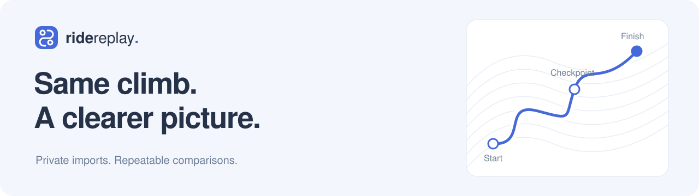
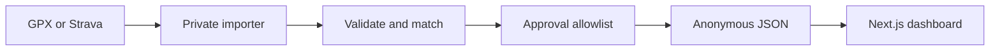

# Ride Replay

[](https://github.com/calin-andrei-rotaru/ride-replay/actions/workflows/checks.yml)
[](https://ride-replay-smoky.vercel.app)


**Am I getting quicker on the same climb?** Ride Replay imports cycling activities, finds repeated passages through a directed climb, and compares elapsed times across rides. Your tracks stay private; the public dashboard reads only an approved, anonymous snapshot.

**[Open the live demo](https://ride-replay-smoky.vercel.app)** · [Quickstart](#quickstart) · [Bring your own rides](#use-your-own-rides) · [Technical guide](docs/guide.md) · [Verification](docs/verification.md)

> [!NOTE]
> The live demo uses **synthetic data**: 15 fixture rides, 12 accepted efforts, and 3 rejected candidates. Real rides and a live Databricks run have not been validated yet.

## What you can do

- **See your progress.** Explore an interactive time chart, compare every effort with your best, filter and sort history, and export CSV.
- **Import your own rides.** Use GPX files or authorize your Strava API app through a temporary local OAuth flow. Identical files import once, even if renamed.
- **Compare the same climb.** Match start → checkpoint → finish in source order. Reject reverse passes, alternate routes, recording gaps, and GPS jumps with explicit reasons.
- **Choose what leaves your computer.** An explicit ride allowlist produces anonymous effort order, rounded durations, and aggregate counts. GPS coordinates and exact ride dates stay private.

## Quickstart

The dashboard runs independently of Python, Strava, and Databricks. Use **Node.js 24** with npm:

```bash
git clone https://github.com/calin-andrei-rotaru/ride-replay.git
cd ride-replay/web
npm ci
npm run dev
```

Open **http://127.0.0.1:3000**. The approved synthetic snapshot is already bundled.

<details>
<summary>Run the private importer and tests locally</summary>

From the repository root, with **Python 3.11+**, in PowerShell:

```powershell
python -m venv .venv
.\.venv\Scripts\python -m pip install -e '.[dev]'
.\.venv\Scripts\python -m ride_replay.cli demo
.\.venv\Scripts\python -m pytest -q
```

On macOS/Linux, use `.venv/bin/python` in place of `.\.venv\Scripts\python`. The `demo` command generates labeled fixtures under ignored `data/demo/` and reproduces the bundled public snapshot.

</details>

## Use your own rides

After installing and activating the Python environment, import a folder of GPX files:

```text
ride-replay import /path/to/rides
```

Or connect your own [Strava API app](https://www.strava.com/settings/api) and choose activity IDs from your rides:

```text
ride-replay strava-sync --connect --activity-id YOUR_FIRST_ID --activity-id YOUR_SECOND_ID
ride-replay import data/strava
```

Credentials are prompted locally; the temporary callback listens only on loopback. Tokens are not persisted. Import access and publication approval are separate steps.

Follow the **[full workflow](docs/guide.md#use-your-own-rides)** to choose a climb, inspect quality results, explicitly approve rides, and regenerate the dashboard snapshot.

## How it fits together



The local Python pipeline preserves file hashes, track boundaries, points, and import lineage in SQLite and private manifests. Shared matching functions also power the prepared PySpark batch job. The Vercel dashboard serves static assets and needs no raw-data credentials or live Databricks connection.

## Project status

- **Working:** local imports, climb matching, private Strava authorization, safe snapshot export, and the deployed dashboard. CI checks Python tests, snapshot reproducibility, the Next.js build, TypeScript, public assets, and Terraform configuration.
- **Prepared:** a parameterized Databricks job with Bronze/Silver/Gold Delta outputs, plus Terraform for private storage and scoped publishing identities.
- **Next:** validate two real efforts, calibrate the geofences against actual sampling, run the Databricks job, and provision cloud resources in an agreed account and budget. Browser visual and interaction QA also remains outstanding.

See the **[verification record](docs/verification.md)** for observed evidence and remaining work.

## Explore the repository

- [`src/ride_replay/`](src/ride_replay/) — GPX and Strava imports, quality checks, matching, and public exports.
- [`web/`](web/) — Next.js dashboard, bundled snapshot, and asset checks.
- [`tests/`](tests/) — import, matching, privacy, and OAuth tests.
- [`databricks/`](databricks/) and [`databricks.yml`](databricks.yml) — reproducible batch job configuration.
- [`infra/`](infra/) — private storage and publishing identities.
- [`docs/guide.md`](docs/guide.md) — setup, import contract, timing methodology, deployment, and infrastructure commands.

For changes, use the **[contributor workflow](CONTRIBUTING.md)**. Commit completed work in small, verified checkpoints.
